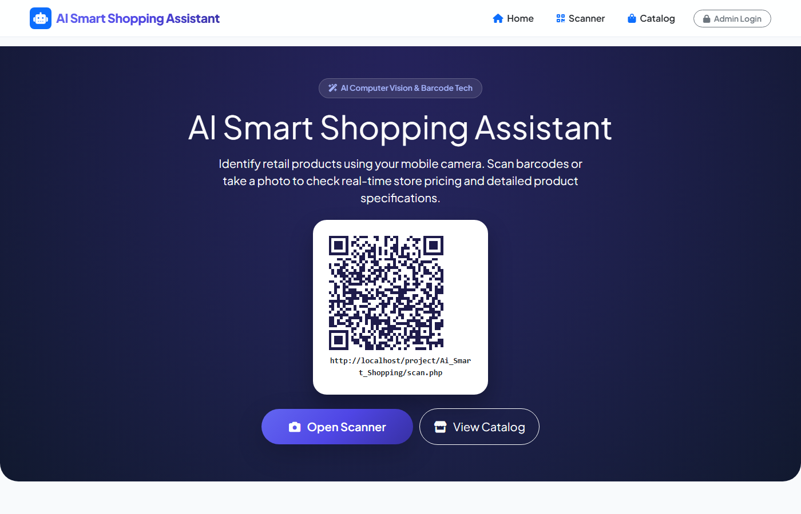
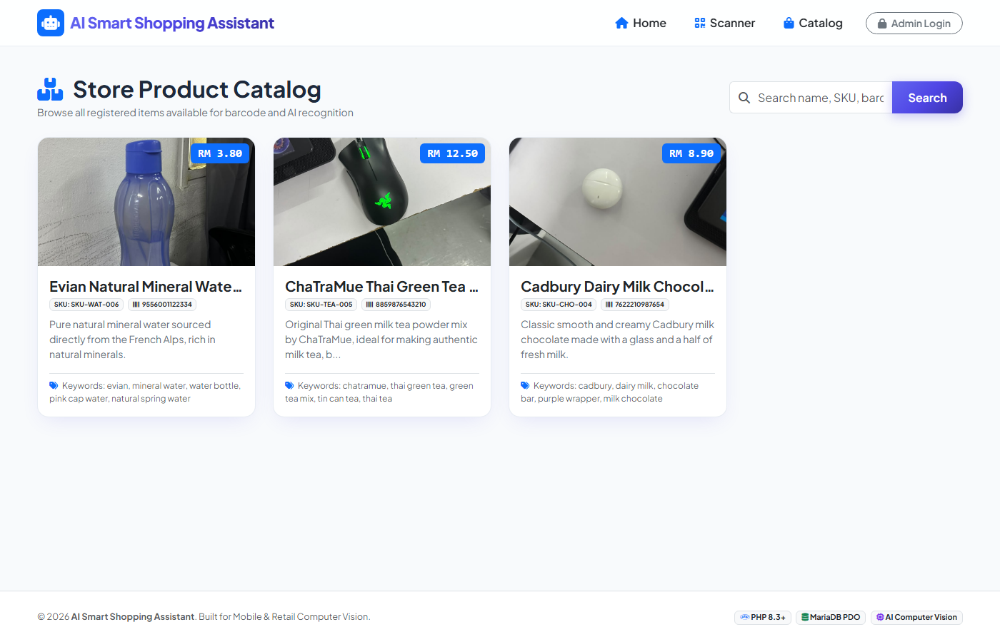
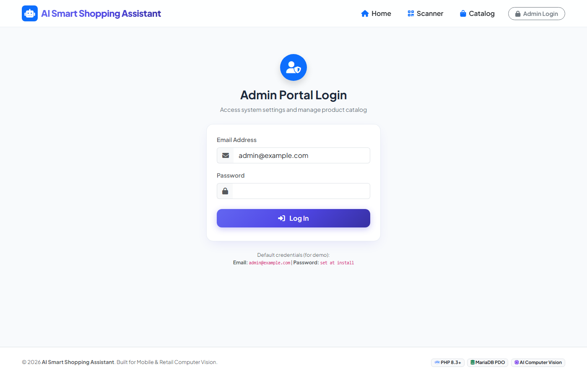
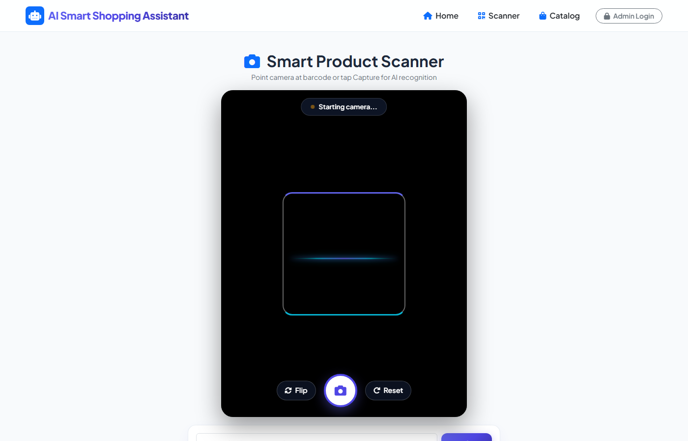
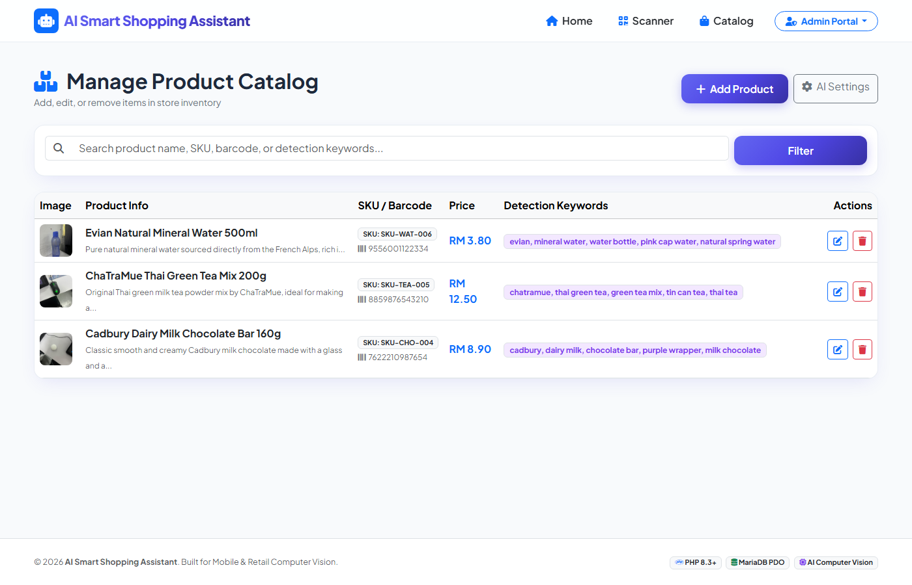

# AI Smart Shopping Assistant

Mobile-first store scanner. Customers scan a barcode or a product photo and see the price stored in MySQL. AI only helps identify the package. It never invents a price.

## Quick start (XAMPP)

1. Place the project in `C:\xampp\htdocs\project\Ai_Smart_Shopping`
2. Start Apache and MySQL in XAMPP
3. Open http://localhost/project/Ai_Smart_Shopping/
4. On `install.php`, the badge must say **Local XAMPP**. The local database is `ai_smart_shopping`, user `root`, with an empty password. If MySQL is on port 3306 or 3307, the app picks the port that accepts that login
5. Click **Install Database & Seed Data Now**
6. Sign in with the demo administrator shown on the login page
7. Open **Scanner** and look up a barcode, SKU, or product photo
8. Open **AI Settings**, enter the provider URL, model, and API key, then click **Test AI Connection**

Opening the site on `localhost` always uses XAMPP. A `includes/config.cpanel.php` file on this computer is ignored until the site is opened on a real domain.

## Features

- Shoppers do not register. The homepage shows a QR code that opens the scanner
- Live barcode reading in the browser (EAN-13, EAN-8, UPC-A, UPC-E, Code 128, Code 39) with ZXing
- Manual lookup by barcode, SKU, or product name
- Photo recognition through Agnes AI or Google Gemini, then a match against the store catalog
- Price, name, and image always come from the `products` table
- Admin can add, edit, search, and delete products, including image upload and detection keywords
- Admin AI settings: provider, base URL, model, fallback models, masked API key, and a connection test
- Sample catalog after install, plus any products added later

## Screenshots

| Home | Catalog |
|:---:|:---:|
|  |  |

| Admin login | Scanner |
|:---:|:---:|
|  |  |

| Manage products |
|:---:|
|  |

Screenshots were taken on localhost. They do not include a live domain, database password, or API key.

## Folder structure

```
Ai_Smart_Shopping/
├── admin/                 Product manager and AI settings
├── api/                   barcode.php, recognize.php, test_ai.php
├── assets/css & js        Layout, scanner, bundled ZXing and QRCode
├── docs/screenshots/      README images
├── includes/              Config, database, auth, catalog, AI, images
├── sql/                   schema.sql and seed.sql
├── uploads/products       Product images
├── uploads/cache          Temporary upload files
├── install.php            Creates the local database, or tables on cPanel
├── index.php              Homepage and QR code
├── scan.php               Barcode and photo scanner
├── products.php           Public catalog
└── login.php              Admin login
```

## 1. XAMPP setup

1. Keep this folder at `C:\xampp\htdocs\project\Ai_Smart_Shopping`
2. Start **Apache** and **MySQL**
3. Open http://localhost/project/Ai_Smart_Shopping/install.php
4. The badge must say **Local XAMPP**. Click install
5. The installer creates the database, tables, administrator, sample products, and placeholder images
6. Open http://localhost/project/Ai_Smart_Shopping/login.php

Local database values already used by the app:

- Host: `127.0.0.1`
- Database: `ai_smart_shopping`
- User: `root`
- Password: empty

To use phpMyAdmin instead, import `sql/schema.sql` and then `sql/seed.sql` into a database named `ai_smart_shopping`.

## 2. Scan a product

On **Scanner**:

- Point the camera at a barcode, or type a code and press lookup
- A number must match the barcode or SKU exactly. A name search is used only when the text contains letters
- If there is no barcode, upload a photo. The active AI provider reads the label, and the catalog matcher accepts a product only when those words appear on a stored product

The camera works on `localhost` or on an HTTPS site. A normal `http://` live domain cannot open the phone camera.

## 3. AI providers

1. Log in and open **AI Settings**
2. Pick **Agnes** or **Gemini**
3. Agnes base URL: `https://apihub.agnes-ai.com/v1`
   - Model: `agnes-2.5-flash`
   - Fallback: `agnes-2.0-flash`
4. Gemini base URL: `https://generativelanguage.googleapis.com/v1beta`
   - Model: `gemini-3.5-flash-lite`
   - Fallback: `gemini-2.5-flash-lite, gemini-flash-lite-latest`
5. Paste the key, click **Test AI Connection**, then **Save Settings**

Do not commit API keys. The settings page only shows a mask. A 503 “high demand” message means the URL and key were accepted and that model is busy. Try the fallback model.

A new live database does not copy keys from this computer. Enter them again after installing on the server.

## 4. cPanel

1. In cPanel → **MySQL Databases**, create the database and user, then add the user to that database with **All Privileges**. This hosting account cannot create a database from PHP
2. In **Select PHP Version**, choose PHP 8.1 or 8.2 and enable `pdo_mysql`, `curl`, `fileinfo`, and `json`
3. On the server, copy `includes/config.cpanel.php.example` to `includes/config.cpanel.php`. Set the host to `localhost` and fill in the database name, user, and password created in cPanel. Never commit `includes/config.cpanel.php`
4. Upload the project. This computer still uses XAMPP. The live domain uses the cPanel database
5. Open `https://your-domain.example/your-folder/install.php`. The badge must say **cPanel**, then click install. It only creates tables
6. Sign in, save the AI keys, then delete `install.php` from the server

## 5. Admin login

Open `login.php`. The installer creates one administrator, and the login page shows that demo account. Change the password before the site is public. There is no separate password-reset page.

## 6. PHP

- Local site: http://localhost/project/Ai_Smart_Shopping/
- PHP 8.1 or newer
- Extensions: `pdo_mysql`, `curl`, `fileinfo`, `json`. `gd` draws the sample product images

To install again on this PC, drop the database `ai_smart_shopping` in phpMyAdmin and open `install.php`. Running the installer a second time does not wipe an administrator password or AI keys that are already saved.

## System flow

1. A shopper opens the homepage or scans the QR code
2. The scanner reads a barcode, or sends a photo to `api/recognize.php`
3. Barcode lookup uses `api/barcode.php` and the `products` table
4. Photo lookup asks Agnes or Gemini for the words printed on the package
5. Those words are matched to the product name, SKU, and detection keywords
6. The page shows the stored name, price, and image, or says the product was not found

## Security notes

- Shoppers have no account. Only the admin role can change products and AI settings
- Passwords are stored with `password_hash()`
- POST forms use a session CSRF token
- Product uploads are checked for MIME type, extension, and size, then saved under a random filename
- `includes/` and `sql/` are blocked by `.htaccess`
- `uploads/` rejects script files. Product images do not use `Options` in `.htaccess`, because some cPanel accounts then return HTTP 500 for every image
- `error.log` cannot be downloaded
- `includes/config.cpanel.php` is listed in `.gitignore`

## License

This project is licensed under the [MIT License](LICENSE).
